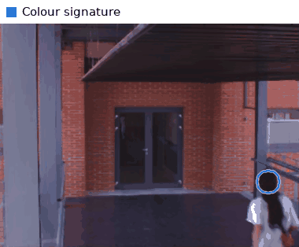
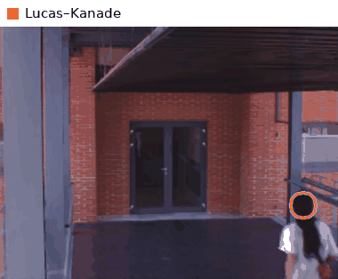
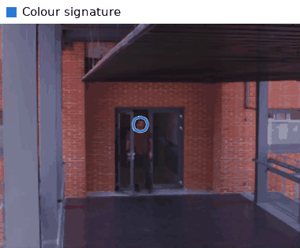
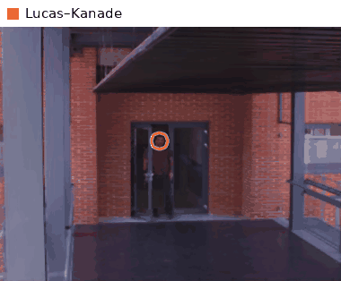
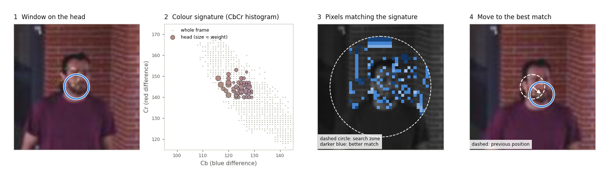

# Head Tracking Based on Colour Signature

A MATLAB tracker that follows a person's head through a video using only its colours. It is compared with a classic Lucas–Kanade tracker.

Javier Molina wrote it in June 2006 as coursework for *Digital Video Processing*. This was a PhD course at the **Video Processing & Understanding Lab (VPU-Lab)** of the Universidad Autónoma de Madrid, then called *Grupo de Tratamiento de Imágenes* (GTI).

## Results

Two sequences recorded on the lab walkway. Each tracker starts from the same window on the head in the first frame.

<table>
  <tr>
    <th width="50%">Colour signature (this work)</th>
    <th width="50%">Lucas–Kanade (baseline)</th>
  </tr>
  <tr>
    <td colspan="2"><b>Walking away from the camera</b></td>
  </tr>
  <tr>
    <td></td>
    <td></td>
  </tr>
  <tr>
    <td>Stays on her dark hair until she goes through the door. It is then left on the door's dark glass, which has the same colours as the hair.</td>
    <td>Slides down from the head to her back, but stays with her.</td>
  </tr>
  <tr>
    <td colspan="2"><b>Walking towards the camera</b></td>
  </tr>
  <tr>
    <td></td>
    <td></td>
  </tr>
  <tr>
    <td>Follows the face for about two thirds of the sequence. As he gets close, it is left behind on the brick wall, whose colour is close to skin.</td>
    <td>Loses the head after about 10 frames and stays on the door.</td>
  </tr>
</table>

<details>
<summary>How these animations were made</summary>

- **Colour signature.** These are the original 2006 runs. In the archived videos ([`media/videos/`](media/videos/)) the 2006 window was a 1-pixel circle on frames that were later shrunk and compressed, so it is almost invisible. Its position was recovered frame by frame ([`python/recover_track.py`](python/recover_track.py)) and redrawn here as a thick circle.
- **Lucas–Kanade.** The original walkway frames no longer exist. This tracker was re-run with a Python port of [`lucas-kanade/lk.m`](lucas-kanade/lk.m) on the frames extracted from the same videos, which are lower resolution than the originals (433 × 324 instead of 1024 × 768). It starts from the same window.
- Everything is regenerated by [`python/make_media.py`](python/make_media.py).

</details>

## How it works

Skin and hair occupy a small, distinctive region of colour space, and that region changes little as the head turns or moves. The tracker ignores brightness and describes the head only by its colours. In each new frame it moves the window to the spot where those colours are most concentrated.



1. **Window on the head.** On the first frame the user outlines the head, and a circle is fitted to it.
2. **Colour signature.** The colours inside the circle are counted in the *Cb–Cr* plane, which holds colour without brightness ([`cbcrHistogram.m`](src/cbcrHistogram.m)). The head forms a compact cluster, apart from most of the frame (grey dots). Very dark or very bright pixels have unreliable colour, so they count only ¼.
3. **Pixels matching the signature.** In the next frame, each pixel inside a search zone around the last position is scored by how common its colour is in the signature ([`locateNewROI.m`](src/locateNewROI.m)). The search zone is three times the window size.
4. **Move to the best match.** The window moves to the position where the average score inside it is highest ([`concentration.m`](src/concentration.m)). The search starts at the previous position and uses the Nelder–Mead method (`fminsearch`). The signature is then updated with the colours at the new position, half old and half new, so it adapts slowly to lighting and pose.

The weakness is visible in the results: anything nearby with the same colours can capture the window, such as dark glass for dark hair or brick for skin. The window also keeps its initial size as the person approaches.

## Usage

Requirements: MATLAB with the Image Processing Toolbox.

```matlab
addpath src

% Track the head through a folder of PNG frames (processed in name order).
% A window opens on the first frame: outline the head and double-click.
trajectory = headtrack('data/pasarela/javi');

% Also write a video with the tracking overlay and save the head crops.
trajectory = headtrack('data/pasarela/javi', ...
                       'OutputVideo', 'javi.avi', ...
                       'CropsDir',    'crops/javi');
```

| Option         | Default | Description |
|----------------|---------|-------------|
| `OutputVideo`  | `''`    | Write a video with the tracking overlay. |
| `FrameRate`    | `2`     | Frame rate of that video. |
| `CropsDir`     | `''`    | Save the tracked region of every frame as a PNG. |
| `Display`      | `true`  | Show each tracked frame on screen. |
| `UpdateWeight` | `0.5`   | Weight of the new colours when updating the signature. |

`trajectory` holds the `[row col]` centre of the window in each frame.

The Lucas–Kanade baseline works on numbered grey-level frames:

```matlab
addpath lucas-kanade
lk('frames/1bw%d.png', 19, 'lk.avi');
```

To regenerate the animations and the figure (Python 3 with NumPy, SciPy, OpenCV, Pillow and Matplotlib):

```bash
cd python && python make_media.py
```

> The original input frames (walkway sequences `javi`, `javiEspalda`, `alvaro`, `alvaroEspalda` and `luis`) are not included. Only the two result videos are.

## Repository layout

```
├── src/              Colour-signature tracker (MATLAB)
│   ├── headtrack.m     entry point
│   ├── trackROI.m      one tracking step
│   ├── locateNewROI.m  match the signature in a new frame and search for the best position
│   ├── concentration.m score of a window position
│   ├── cbcrHistogram.m colour signature
│   ├── shiftROI.m, addTrackingROI.m
│   └── runCatwalk.m    batch run over the walkway sequences
├── lucas-kanade/     Lucas–Kanade baseline (MATLAB, third party)
├── python/           Python ports of both trackers and the scripts that build media/
└── media/
    ├── gifs/           result animations
    ├── figures/        explanatory figure
    └── videos/         original 2006 result videos
```

## About this version

The code was tidied up from the original coursework, and the algorithm is unchanged. Names are now in English, and the per-pixel loops were replaced by whole-image operations. Several bugs were fixed: crops were saved over each other, and moving the window past the image border crashed. Unused experiments and the obsolete QuickTime writer were removed. The MATLAB code has not been re-run, because the original frames are not available.

## Credits

- Colour-signature tracker: **Javier Molina**, VPU-Lab (formerly GTI), Universidad Autónoma de Madrid, 2006.
- Lucas–Kanade implementation: **Rohit Singh and Mitul Saha**, Stanford CS223b. The original header is kept in [`lucas-kanade/lk.m`](lucas-kanade/lk.m).
- B. D. Lucas and T. Kanade, *An Iterative Image Registration Technique with an Application to Stereo Vision*, IJCAI 1981.

## License

[MIT](LICENSE), except the third-party code in [`lucas-kanade/`](lucas-kanade/), which keeps its original authorship.
